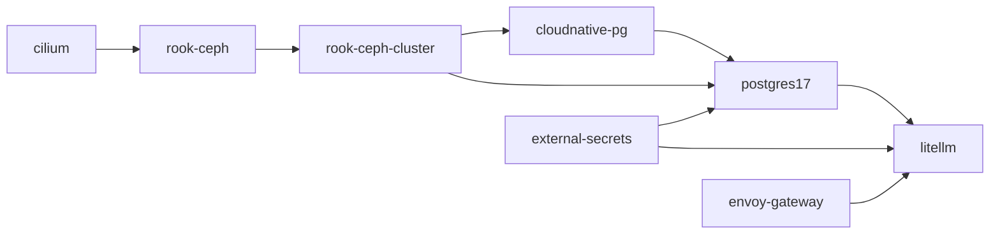
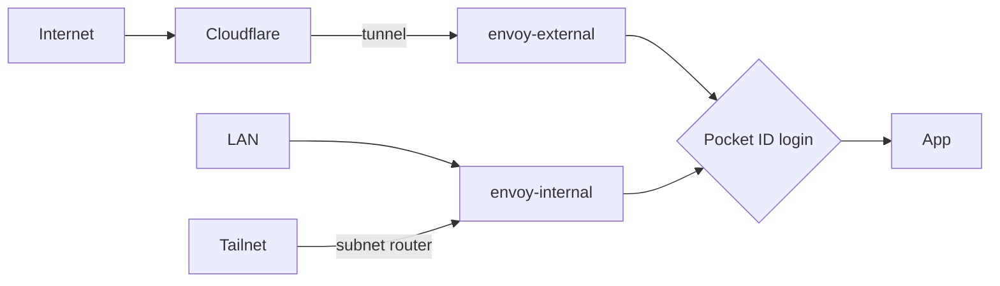

<div align="center">

# k8s-gitops

_A four-node Talos cluster at home, run from this repository by Flux and Renovate_

[](https://github.com/carpenike/k8s-gitops/actions/workflows/validate.yaml)&nbsp;
[](https://github.com/renovatebot/renovate)&nbsp;
[](LICENSE)

</div>

---

## Overview

This repository is the desired state of a home Kubernetes cluster.
[Talos](https://www.talos.dev) is the node OS, [Flux](https://fluxcd.io)
applies what is committed here, and [Renovate](https://github.com/renovatebot/renovate)
opens the pull requests that keep it current. Nothing is applied by hand
after bootstrap.

It is the second version of this cluster. The first one grew three block
stores, two ways to do ingress and more than one identity provider. This
one keeps one of each. The old tree is the tag `archive/talos-v1`, and
[docs/history/lessons-from-v1.md](docs/history/lessons-from-v1.md) says what it taught.

The decisions behind the choices below are recorded in
[docs/adr/](docs/adr/). The full component list is
[docs/architecture.md](docs/architecture.md).

## Hardware

One chassis, four sleds. Three sleds are control planes that also run
workloads. The fourth is a worker. All four are Ceph hosts.

| | |
| --- | --- |
| Chassis | Supermicro SYS-2028TP-HTR, 2U, four nodes |
| CPU, per sled | 2 × Intel Xeon E5-2695 v3 (28 cores, 56 threads) |
| Memory, per sled | 128 GB (`sled-0` has 192 GB) |
| Boot disk | Samsung SSD 870, 500 GB |
| Ceph disks | 3 SATA SSDs per sled, 12 OSDs in all, 800 GB to 960 GB each |
| Network | One 10G port per sled to a UniFi switch, iBGP to a MikroTik router |
| Power | APC UPS with a network card, polled by NUT on every sled |

A single chassis is one failure domain. A sled can fail and the cluster
carries on; the chassis cannot. Backups leave the chassis, and the things
that have to outlive it stay off the cluster:

- **Forge**, a NixOS host, runs Plex, home automation, Pocket ID,
  Alertmanager and the BMC monitoring for the sleds.
- **NAS boxes** serve media over NFS and hold backups. They are not
  Kubernetes nodes.

## Platform

- **Node OS and upgrades**: [Talos](https://www.talos.dev) images from
  Image Factory, machine config rendered by
  [topf](https://github.com/postfinance/topf) from [talos/](talos/), and
  [tuppr](https://github.com/home-operations/tuppr) for Talos and
  Kubernetes upgrades.
- **Networking**: [Cilium](https://github.com/cilium/cilium) replaces
  kube-proxy and advertises LoadBalancer addresses over BGP.
  [Multus](https://github.com/k8snetworkplumbingwg/multus-cni) sits in
  front of it for the few pods that need a second interface on a VLAN
  ([ADR 0007](docs/adr/0007-multus.md)).
- **Ingress**: [Envoy Gateway](https://github.com/envoyproxy/gateway)
  with two gateways. `envoy-external` is reached through a
  [Cloudflare tunnel](https://github.com/cloudflare/cloudflared).
  `envoy-internal` is reached from the LAN, and from the tailnet through
  a [Tailscale](https://github.com/tailscale/tailscale) subnet router
  ([ADR 0012](docs/adr/0012-tailscale-subnet-router.md)).
- **Login**: HTTPS on both gateways needs a Pocket ID login unless a
  route opts out ([docs/platform/gateway-auth.md](docs/platform/gateway-auth.md)).
- **DNS and certificates**: two
  [external-dns](https://github.com/kubernetes-sigs/external-dns)
  instances. One writes public names to Cloudflare. The other writes
  internal names to the router through the
  [MikroTik webhook](https://github.com/mirceanton/external-dns-provider-mikrotik)
  ([ADR 0003](docs/adr/0003-internal-dns.md)).
  [cert-manager](https://github.com/cert-manager/cert-manager) issues
  wildcard certificates with DNS-01.
- **Secrets**: [External Secrets](https://github.com/external-secrets/external-secrets)
  reads 1Password with a service account, so there is no Connect server
  to keep alive. SOPS is for bootstrap only
  ([ADR 0002](docs/adr/0002-secrets.md)).
- **Storage**: [Rook-Ceph](https://github.com/rook/rook) for block,
  file and object. A static NFS class for media.
  [VolSync](https://github.com/backube/volsync) backs up volumes.
- **Postgres**: one shared [CloudNativePG](https://github.com/cloudnative-pg/cloudnative-pg)
  cluster, `postgres17`, with continuous backup to Cloudflare R2
  ([docs/platform/postgres17.md](docs/platform/postgres17.md)).
- **Observability**: Prometheus from
  [kube-prometheus-stack](https://github.com/prometheus-community/helm-charts),
  alerting to Forge, with Grafana and Grafana OnCall in the cluster
  ([docs/platform/grafana.md](docs/platform/grafana.md)).
- **Sandboxing**: [Kata Containers](https://github.com/kata-containers/kata-containers)
  runtime classes put agent desktops and privileged CI jobs in VMs
  ([ADR 0009](docs/adr/0009-kata.md), [ADR 0011](docs/adr/0011-kata-ci-runners.md)).
- **Housekeeping**: [spegel](https://github.com/spegel-org/spegel) as a
  local image mirror, [reloader](https://github.com/stakater/Reloader),
  and [Actions Runner Controller](https://github.com/actions/actions-runner-controller)
  for self-hosted runners ([docs/platform/actions-runners.md](docs/platform/actions-runners.md)).

## What runs on it

| Namespace | What | Doc |
| --- | --- | --- |
| `hermes-<bot>`, `hermes-memory` | [Hermes](https://github.com/NousResearch/hermes-agent) agents on Matrix, one namespace per bot, each with a Kata-sandboxed desktop, and a shared memory server | [hermes.md](docs/apps/hermes.md), [hermes-memory.md](docs/apps/hermes-memory.md) |
| `litellm` | LLM proxy, and the virtual keys the bots call it with | [litellm.md](docs/apps/litellm.md) |
| `homelab-mcp` | MCP tools server for Claude and the bots | [homelab-mcp.md](docs/apps/homelab-mcp.md) |
| `openproject` | Task board shared by people and bots | [openproject.md](docs/apps/openproject.md) |
| `matrix` | Tuwunel homeserver | [matrix.md](docs/apps/matrix.md) |
| `mail` | Stalwart mail server, with an edge relay outside the house | [mail.md](docs/apps/mail.md) |
| `scrypted` | Camera NVR | [scrypted.md](docs/apps/scrypted.md) |
| `grafana` | Grafana and Grafana OnCall | [grafana.md](docs/platform/grafana.md) |
| `lading`, `schoolhouse` | Scheduled syncs from private repositories that feed `homelab-mcp` | [lading.md](docs/apps/lading.md), [schoolhouse.md](docs/apps/schoolhouse.md) |
| `web` | A static site | [website.md](docs/apps/website.md) |
| `headlamp` | Read-only cluster UI | [headlamp.md](docs/platform/headlamp.md) |

## How it works

### GitOps

The Flux Operator runs one Flux instance, and that instance syncs
[kubernetes/apps](kubernetes/apps/). There is no root kustomization.
Flux includes every child directory that has a `kustomization.yaml`,
which is one per namespace. Each of those lists the Flux Kustomizations
(`ks.yaml`) for its apps, and each `ks.yaml` points at an `app/` folder
holding a HelmRelease and whatever goes with it.

```text
kubernetes/
├── apps/<namespace>/<app>/
│   ├── ks.yaml              Flux Kustomization, and what it depends on
│   └── app/
│       ├── helmrelease.yaml
│       ├── ocirepository.yaml
│       └── externalsecret.yaml
├── components/              Kustomize components shared between apps
└── examples/                Documentation in YAML. Flux does not apply it
```

A merge to the branch Flux watches is a deploy. Renovate opens its pull
requests on weekends. Every image and chart is pinned, self-built images
by digest.

### Dependencies

A Flux Kustomization waits for the ones it names in `dependsOn`. This is
the chain under LiteLLM, where an arrow means "must be ready first":



### Reaching an app



Public names are Cloudflare records that point at the tunnel. Internal
names are A records on the router that point at `envoy-internal`. There
is no public wildcard, so a name with no route does not resolve.

### Checks

Every pull request runs
[validate.yaml](.github/workflows/validate.yaml): yamllint, kubeconform,
a check that every `*.sops.yaml` is encrypted, `helm template` of each
HelmRelease against its chart, gitleaks, and the Renovate config
validator. None of it needs a cluster or a secret. The same checks run
locally:

```sh
mise install
mise run validate
```

## Repository layout

| Path | Role |
| --- | --- |
| [kubernetes/apps](kubernetes/apps/) | What Flux syncs |
| [kubernetes/components](kubernetes/components/) | Shared Kustomize components, including the one every Hermes bot is built from |
| [talos/](talos/) | topf inventory and machine config patches |
| [bootstrap/](bootstrap/) | The helmfile that installs Cilium, CoreDNS, spegel, cert-manager and Flux before Flux takes over |
| [images/](images/) | Dockerfiles for the few images built here and pushed to GHCR |
| [scripts/](scripts/) | Validation and the bootstrap sequence |
| [docs/](docs/) | Architecture, platform and app guides, and decision records |
| [AGENTS.md](AGENTS.md) | Instructions for coding agents |

## Cloud dependencies

Most of this is self-hosted. These are not, either because the cluster
needs them before it can start or because they have to work when it is
down.

| Service | Used for |
| --- | --- |
| [1Password](https://1password.com) | Source of every app secret |
| [Cloudflare](https://www.cloudflare.com) | DNS, the tunnel, DNS-01 certificates, and R2 for backups |
| [GitHub](https://github.com) | This repository, Actions, GHCR and Renovate |
| [Tailscale](https://tailscale.com) | Remote access to the internal gateway, and the path inbound mail takes |
| [Vultr](https://www.vultr.com) | One VM, the mail edge relay ([ADR 0014](docs/adr/0014-mail-edge-relay.md)) |
| [Azure](https://azure.microsoft.com) | The models behind LiteLLM |

## What is not in git

Age keys, Talos secrets, the 1Password service-account token, and every
password and API token. App secrets come from 1Password at run time. The
few bootstrap secrets are created by a person on a workstation;
[bootstrap/README.md](bootstrap/README.md) and
[talos/README.md](talos/README.md) describe that sequence.
`cluster.example.toml` records the inputs with placeholders. It is not a
live config.

## Documentation

Start at [docs/README.md](docs/README.md). If you are a coding agent,
start at [AGENTS.md](AGENTS.md).

## Thanks

This tree started from
[onedr0p/cluster-template](https://github.com/onedr0p/cluster-template);
[docs/deviations.md](docs/deviations.md) lists where it left. It leans on
the charts, schemas and Renovate presets published by
[home-operations](https://github.com/home-operations), on
[bjw-s](https://github.com/bjw-s-labs/helm-charts)'s app-template chart,
and on the many clusters shared at [kubesearch.dev](https://kubesearch.dev).

## License

[MIT](LICENSE)
